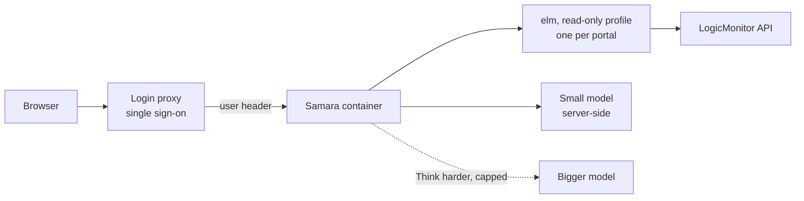

# Samara on a shared server: design note

Status: proposal, 2026-10-29. Nothing here is built yet.

## Goal

Let people ask LogicMonitor questions in plain English from a browser, without
running an AI model or Docker on their own laptop. One Samara serves a team or
a company; people sign in with their normal work login.

## Why now

Samara answers with whichever model it is given. Run against a small local
model (qwen3-8b, 2026-10-29), most of the questions in `questions.md` went
wrong: it read counts off a 5-row sample, looked devices up by hostname, and
made figures up when a query failed. Recipes (`recipes.yaml`) fix this for the
common questions: the queries, the counting and the summary are worked out and
checked in advance, so the model only picks a recipe and passes a name. A
model that small is cheap to run centrally, and Think harder (a bigger model,
paid per question) is needed only for the rest.

## What stays the same

- elm underneath, read-only: GET requests only, a profile restricted with
  `allowed_commands`, no `-f api`/`curl`/`wget` (they print the signed header).
- The page, the recipes, the tools and the model ladder (`SAMARA_MODEL`).
- One container image. A shared server is the same image with different
  settings, not a fork.

## Decisions

### 1. The AI: one server-side setup, no personal keys

| Step | Runs on | Who pays |
|---|---|---|
| Ask (pick a recipe, simple questions) | A small model on the server, or the organisation's approved AI service through its OpenAI-compatible API (`SAMARA_MODEL_URL`) | Fixed cost, shared |
| Think harder / Ultrathink | A bigger model | One organisation key, with a monthly cap |

Personal AI keys are not needed: nobody should have to buy one to ask whether
a server is up, and keys pasted into a shared server become something to
protect. If the organisation has an approved AI platform, use it, so portal
data goes only where the organisation already allows. The page already says
when Think harder sends data somewhere new; keep that.

### 2. Sign-in: in front of Samara, not inside it

Put Samara behind the organisation's single sign-on with a standard login
proxy (for example oauth2-proxy, or the sign-in feature of the existing
reverse proxy). The proxy passes the signed-in user's name in a header;
Samara trusts that header only from the proxy and uses it for logging and
limits. Samara never stores passwords and has no account system.

### 3. LogicMonitor access: shared read-only profiles first

| Option | For | Against |
|---|---|---|
| **A. One read-only API token per portal, set up by an admin** (what the `ai` profile does today) | Nothing for users to manage; nobody hands over credentials; matches today's code | Everyone who can sign in sees the same data |
| B. Each user's own LM token | Answers follow each person's LM permissions | Samara must store everyone's credentials safely, which makes it a target; users must create and rotate tokens |

Start with A. Move to B only if people genuinely must not see each other's
portals or groups, and then keep tokens in a secrets store, never in the
container or the repo. A middle step if needed: map sign-in groups to the
portal profiles each group may use.

## Shape

## Work to do

1. **Portal picker.** Profiles exist; the page needs a way to choose one, and
   the server a list of which profiles it offers.
2. **Who asked what.** Log each question with the signed-in user, the portal,
   the recipe or queries used, and the cost. No answers or portal data in the
   log by default.
3. **Limits.** Per-user limits on Think harder, and a monthly total cap.
4. **Short-lived cache.** Everyone shares one LM token per portal, and its
   rate limit. Cache recipe queries for about a minute, so twenty people
   asking "which devices are down?" cause one fetch, not twenty.
5. **Close what is open today.** `/api/health` lists the portal and the
   allowed commands, and there is no sign-in check. Behind the proxy this is
   fine; Samara should also refuse requests that did not come through it.
6. **Conversations.** They live in memory in one process (`app.py`), and are
   lost on restart. That is fine for one server; more than one needs sticky
   sessions or a shared store.
7. **More recipes.** Every common question that becomes a recipe is one the
   cheap model can answer. Questions that reach Think harder are the list of
   recipes to write next.

## Risks

- **Prompt injection reaches more people.** Text planted in a device's
  description or properties can try to steer the answer. Recipes never put
  that text in front of the model; the free-form path does. Keep the injection
  questions in `questions.md` and run them after every model or prompt change.
- **Personal data in answers.** Redaction removes fields named `email`,
  `phone` and `contacts`, but people's addresses also sit in other fields: who
  acknowledged a collector or alert (`ackedBy`), who set an SDT (`admin`), and
  custom properties holding a user name. In testing, two answers passed an
  email address straight to the reader. On a shared server everyone who can
  sign in would see them. Redact by value (anything shaped like an email
  address), not only by field name, before rows reach the model, jq or the page.
- **Wrong answers at scale.** A shared tool is trusted more than a personal
  experiment. Run `questions.md` against the configured model before opening
  it up, and say on the page which answers came from a recipe.
- **Cost.** Think harder is per question. The cap and the per-user limits
  are what keep a shared key safe to offer.
- **A stolen LM token.** It is read-only and restricted to the allowed
  commands, which limits the damage; rotate it like any service credential.

## Phases

1. Finish and measure the recipes against the small model (`questions.md`).
2. One container on an internal server, behind sign-in, with admin-set
   read-only profiles and a server-side model. Work items 1-5.
3. Only if needed: per-group portal access, then per-user LM tokens.

## Open questions

- Which model serves the Ask step: one on the server (needs a machine with
  enough memory or a GPU), or the organisation's AI service?
- Which portals, and who may use each?
- Who owns the server, the LM tokens and the AI budget?
